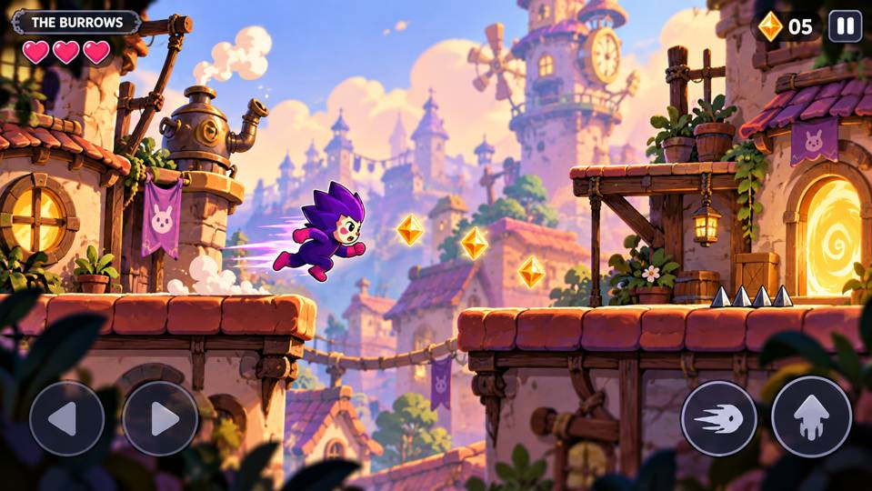

# Chog Hideout

A browser-playable Chog rooftop heist. Recover the Pocket Sun, escape through a changed route, and restore the light at home. The earlier movement/editor experiments remain in the playtest lab.

The chosen production art direction is **Rooftop Mischief**. Its illustrated world and story are documented alongside the working gameplay experiment.



*Concept art target. The focused game now uses illustrated city, rooftop, prop, and character assets inspired by this direction.*

## Run locally

Requires Node.js 20 or newer. No dependencies or installation step are needed.

```bash
npm run dev
```

Open **http://localhost:8080**. Alternatively, serve `dist/` with a static HTTP server. The files in `dist/` are the editable, buildless application source.

```bash
npm test
```

## Borrowed Sunshine — first heist

Open **http://localhost:8080/play.html** for the illustrated heist. The bridge retracts and a shutter closes after pickup; return home via the upper maintenance route and a leftward dash crossing. It has a layered city, textured rooftops, eight character poses, touch controls, and pause/retry. Movement now has interpolated presentation, landing dust, dash trails, sparkle bursts, and original synthesized sound cues. Sound starts after pressing Play and can be muted with the music-note button; the preference is saved on this browser. `/movement.html` redirects here. The technical Canvas/Phaser comparison is preserved at `/renderer-lab.html`; both use the same movement simulation.

See [art implementation notes](docs/ART_IMPLEMENTATION.md) for asset briefs, provenance, and validation limits.

## Play

| Action | Keyboard | Touch |
| --- | --- | --- |
| Move | Left/right arrows or A/D | Direction buttons |
| Jump | Space, W, or up arrow | Jump button |
| Dash | Shift or X | Dash button |
| Retry | R | Restart button |

Jump before a gap, then dash in the air. Dash adds distance, not invulnerability. Sparks are optional. Recover the Pocket Sun from its plinth, turn left, and bring it home to finish. The vault checkpoint supports practice retries after pickup; clean-heist and escape records are separate and browser-local. R restarts the whole heist. The original lab still uses an exit flag. The editor lets you place up to five traps in a short room and save the layout after completing it.

An earlier **Dojo** experiment remains available in the comparison tab. It uses deterministic fights and editable behaviour rules; Hideout is the current gameplay direction.

## What exists

- A complete two-phase heist with a retracted bridge, closed shutter, roof bypass, Sun carry cue, and home restoration.
- A vault checkpoint, clean-heist/practice records, and direction-aware camera.
- Three original scrolling raids, jump buffering, coyote time, and dash cooldown.
- Keyboard and touch-input handlers.
- High-contrast illustrated traps with static warning markers, plus illustrated bridge, shutter and Pocket Sun assets.
- Local trap editor with completion-gated saving.
- Replays of the player's own attempts.
- Browser-local personal bests and copyable feedback.
- World and art bible, supporting cast, opening story arc, and approved visual reference.
- Automated checks covering simulation, timing sweeps, camera framing, and DOM-mock interaction flows.

## What is planned

- Further animation cleanup, richer foreground structure, and consistent chapter art.
- More missions in **The Missing Light** after external playtests validate the first heist.
- Ambient soundscape, story payoff, and further in-game polish.
- Verified Chog ownership, owner-controlled shared hideouts, and limited guest permissions.

NFT integration, shared rooms, and wallet connections are **not implemented**. The new illustrated assets are a playable art pass, not a finished production animation pipeline. Current saves and statistics belong to the browser. Dojo has a cautious strategy that beats all sample opponents and is not evidence of lasting strategic depth.

## Known playtest issue

The unfair crossings have been shortened and given at least 200 world units of clear landing space before the next spike. Dash holds height briefly. Timing sweeps cover a range of jump positions and dash delays. These checks establish broader mechanical tolerance, not enjoyable touch feel: real-browser and device validation are still required.

## Project files

| Path | Purpose |
| --- | --- |
| `dist/engine.mjs` | Movement, collision, room data, and Dojo combat rules |
| `dist/app.mjs` | Rendering, controls, menus, editor, replay, and local progress |
| `dist/index.html` / `dist/style.css` | Playtest interface |
| `tests/` | Automated checks |
| `dist/play.html` / `dist/play.mjs` / `dist/play.css` | Illustrated full-screen game |
| `dist/world-renderer.mjs` / `dist/assets/` | Layered scene and optimized raster assets |
| `dist/heist.mjs` / `dist/heist-records.mjs` | Two-phase mission, checkpoint and versioned local records |
| `dist/heist-visuals.mjs` | Mechanism states, Sun and home restoration |
| `docs/HEIST_SLICE.md` | Implemented mission, validation and limits |
| `dist/renderer-lab.html` / `dist/renderer-lab.mjs` | Technical renderer comparison |
| `dist/art.mjs` | Code-drawn mascot reference |
| `docs/MOVEMENT_SLICE.md` | Tuning changes, verification, and remaining validation |
| `docs/WORLD_AND_ART_BIBLE.md` | Proposed universe, art rules, and production plan |
| `docs/art-direction/rooftop-mischief.jpg` | Selected concept image |
| `scripts/serve.mjs` | Dependency-free local development server |

## Lore and artwork

The new story, characters, and locations are proposed game lore, not official Chog canon. The visual concept uses Chog as a character reference. No licence to the underlying Chog brand or collection artwork is granted by this repository.

Official project: https://www.chog.xyz/ · Hackathon: https://chogathon.chog.xyz/
